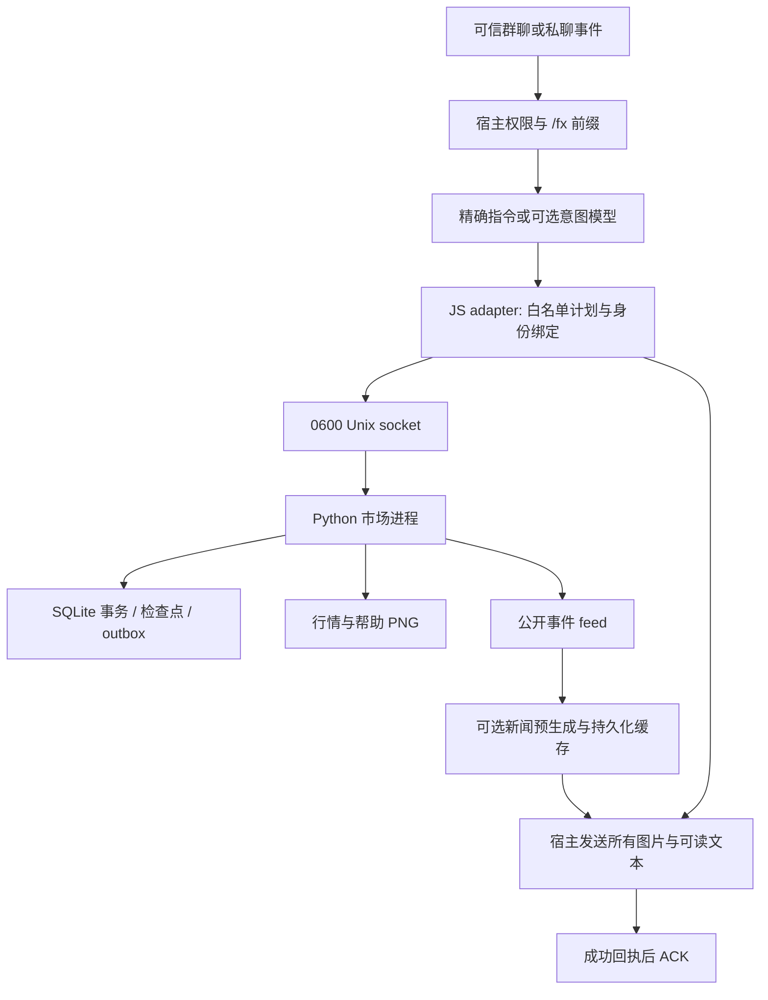

# 架构与边界

## 进程与状态

每个市场一个 Python 进程、一个 state 目录和一个 SQLite。多个群可映射到同一市场；不同 state 目录的市场独立。当前配置和股票池有进程级可变对象，不能在同进程中同时实例化多个市场来宣称隔离。

数值推进、交易、日结和恢复通过可重入交易锁、SQL 事务、内存快照及检查点协调。操作 ID 与请求指纹绑定；重复同请求返回原结果，内容变更报冲突。业务成功与消息发送成功是两个状态：前者写入账本/outbox，后者由宿主实际投递并 ACK。

## 信任层级

- 用户文本和模型输出是不可信输入，只能形成白名单 `method/params`。
- 宿主选择账号、群号、市场、管理员身份和操作 ID，不能让模型提供这些字段。
- socket 只允许同操作系统用户访问；同 UID 程序具有调用能力。它不是抵抗同 UID 恶意进程的鉴权系统。
- `private=true` 是强制私聊边界，资金、持仓等原始 JSON 不应进入群模型上下文。
- seed、隐藏经营真值、未来事件分支、检查点和数据库只能留在本机受保护目录。

## 包结构

| 路径 | 职责 |
| --- | --- |
| `src/astrbot_plugin_sharemarket/market` | 传统/因果引擎、事件、公开信息、日历、撮合 |
| `src/astrbot_plugin_sharemarket/game` | 账户、交易、信用、发行、结算与恢复 |
| `src/astrbot_plugin_sharemarket/storage` | SQL 模式、事务、资金与备份 |
| `src/astrbot_plugin_sharemarket/render` | 通用规则卡、行情图、K 线和账户图 |
| `sdk/adapter.mjs`、`sdk/tools.mjs` | 可信消息接入、业务工具和投递回执 |
| `sdk/rpc.mjs` | 本地协议及所有图片路径检查 |
| `sdk/sharemarket-news-*.js` | 公开事件报道、校验、持久化新闻缓存 |
| `sdk/llm.mjs` | 可选、配置驱动的 JSON 文本模型调用 |

宿主的群聊天并发、人设工作区、长期记忆、统一消息队列、平台重试和限频没有迁入。示例不会自动启动这些服务。
